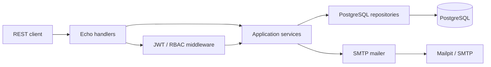

<div align="center">

# Authnode

### Безопасный passwordless-сервис аутентификации на Go

Регистрация и вход по одноразовому коду, JWT, ротация refresh-токенов, отзыв сессий и RBAC.


</div>

---

## О проекте

**Authnode** — законченный backend-сервис, который реализует passwordless-аутентификацию пользователей по email. Проект создан как pet-проект Go-разработчика и демонстрирует не только написание API, но и навыки проектирования безопасного auth-flow, работы с PostgreSQL, тестирования и подготовки сервиса к эксплуатации.

Вместо обычного CRUD здесь решаются задачи, близкие к production-разработке:

- защита одноразовых кодов и refresh-токенов;
- предотвращение повторного использования сессии;
- транзакционная регистрация пользователя;
- разграничение доступа по ролям;
- корректный lifecycle приложения;
- воспроизводимый запуск и автоматические проверки.

## Что демонстрирует проект

| Область | Реализация |
|---|---|
| Go | Явные зависимости, небольшие интерфейсы, `context.Context`, graceful shutdown |
| API | REST на Echo, единый формат ошибок, OpenAPI 3.0 |
| PostgreSQL | Ручные SQL-запросы, ограничения, индексы и транзакции |
| Безопасность | HMAC OTP, JWT claims validation, hashed refresh tokens, rotation |
| Тестирование | Table-driven tests, test doubles, HTTP tests, race detector |
| Инфраструктура | Docker, Compose, Mailpit, versioned migrations |
| Качество | `gofmt`, `go vet`, golangci-lint, Dependabot, GitHub Actions |

## Возможности

- Регистрация пользователя с подтверждением email.
- Passwordless-вход по шестизначному одноразовому коду.
- Короткоживущий JWT access token.
- Одноразовый opaque refresh token.
- Автоматическая ротация refresh-токена при обновлении пары.
- Защита от повторного использования старого refresh-токена.
- Выход из одной сессии или со всех устройств.
- Role-Based Access Control для защищённых маршрутов.
- Ограничение количества попыток ввода OTP.
- Cooldown на повторную отправку кода.
- Liveness и readiness endpoints.
- Отдельное тестовое SMTP-окружение через Mailpit.

## Архитектура



Проект сознательно оставлен **одним сервисом**. Для этой предметной области понятный модульный монолит лучше демонстрирует инженерные навыки, чем искусственное разделение на несколько микросервисов.

Зависимости направлены внутрь:

```text
transport → application service → consumer-owned interfaces → infrastructure
```

Точка входа только собирает зависимости и управляет lifecycle. HTTP-слой не выполняет SQL, а repository не содержит бизнес-правил.

## Безопасность

Безопасность является основной частью проекта, а не дополнительной функцией.

### Одноразовые коды

- Код создаётся через `crypto/rand`.
- Используется шестизначный OTP.
- API никогда не возвращает код клиенту.
- В базе хранится только HMAC-SHA-256 от OTP.
- HMAC подписывается отдельным секретом `OTP_PEPPER`.
- Есть срок действия, cooldown и максимальное число попыток.
- OTP и персональные данные не выводятся в логи.

### Access JWT

Access token содержит и проверяет:

- `iss` — издатель;
- `aud` — аудитория;
- `sub` — идентификатор пользователя;
- `jti` — уникальный идентификатор токена;
- `iat`, `nbf` и `exp`;
- `token_type=access`;
- роли пользователя.

При разборе разрешён только ожидаемый алгоритм HS256.

### Refresh-сессии

- Refresh token содержит 256 бит криптографической случайности.
- В PostgreSQL хранится только SHA-256 digest токена.
- При обновлении старая сессия атомарно удаляется.
- Повторное использование старого токена отклоняется.
- Можно отозвать одну сессию или все сессии пользователя.

### Регистрация

Создание пользователя, назначение роли `user` и удаление registration session выполняются в одной транзакции. Частично созданный пользователь не остаётся в базе при ошибке.

## Быстрый запуск

Понадобится Docker с поддержкой Compose.

```bash
git clone <repository-url>
cd authnode
docker compose up --build
```

После запуска доступны:

| Сервис | Адрес |
|---|---|
| REST API | http://localhost:8000 |
| OpenAPI | http://localhost:8000/openapi.yaml |
| Mailpit | http://localhost:8025 |
| PostgreSQL | localhost:5555 |
| Liveness | http://localhost:8000/live |
| Readiness | http://localhost:8000/ready |

Compose самостоятельно:

1. запускает PostgreSQL;
2. ожидает его готовности;
3. применяет versioned migration;
4. запускает Mailpit;
5. запускает Authnode.

## Демонстрационный сценарий

### 1. Начать регистрацию

```bash
curl -i http://localhost:8000/api/v1/auth/registrations   -H "Content-Type: application/json"   -d '{
    "firstName": "Ada",
    "lastName": "Lovelace",
    "nickname": "ada_dev",
    "email": "ada@example.com",
    "acceptedPrivacyPolicy": true
  }'
```

Ответ содержит идентификатор registration session и время истечения кода. Сам OTP доступен только в письме по адресу http://localhost:8025.

### 2. Подтвердить email

```bash
curl -i http://localhost:8000/api/v1/auth/registrations/confirm   -H "Content-Type: application/json"   -d '{
    "registrationSessionId": "<uuid>",
    "code": "123456"
  }'
```

### 3. Запросить код для входа

```bash
curl -i http://localhost:8000/api/v1/auth/login/code   -H "Content-Type: application/json"   -d '{"email":"ada@example.com"}'
```

Сервис возвращает одинаковый ответ для существующего и неизвестного email, чтобы не раскрывать наличие аккаунта.

### 4. Получить пару токенов

```bash
curl -i http://localhost:8000/api/v1/auth/login/confirm   -H "Content-Type: application/json"   -d '{"email":"ada@example.com","code":"123456"}'
```

### 5. Обновить токены

```bash
curl -i http://localhost:8000/api/v1/auth/tokens/refresh   -H "Content-Type: application/json"   -d '{"refreshToken":"<refresh-token>"}'
```

После успешного запроса исходный refresh token больше нельзя использовать.

## Основные endpoints

| Метод | Endpoint | Назначение |
|---|---|---|
| `POST` | `/api/v1/auth/registrations` | Начать регистрацию |
| `POST` | `/api/v1/auth/registrations/confirm` | Подтвердить email |
| `POST` | `/api/v1/auth/registrations/resend` | Отправить новый OTP |
| `POST` | `/api/v1/auth/login/code` | Запросить код входа |
| `POST` | `/api/v1/auth/login/confirm` | Получить пару токенов |
| `POST` | `/api/v1/auth/tokens/refresh` | Выполнить rotation |
| `POST` | `/api/v1/auth/logout` | Завершить одну сессию |
| `POST` | `/api/v1/auth/logout-all` | Завершить все сессии |
| `GET` | `/api/v1/auth/me` | Получить claims пользователя |
| `GET` | `/live` | Проверить процесс |
| `GET` | `/ready` | Проверить БД и готовность |

Полный контракт находится в [api/openapi.yaml](api/openapi.yaml).

## Структура репозитория

```text
.
├── cmd/auth/                       точка входа
├── configs/                        загрузка и проверка конфигурации
├── internal/
│   ├── api/rest/                   handlers, middleware и router
│   ├── domain/                     модели и domain errors
│   ├── repository/postgres/        SQL repositories
│   └── service/                    бизнес-логика аутентификации
├── migrations/                     versioned PostgreSQL migrations
├── api/openapi.yaml                публичный REST-контракт
├── Dockerfile                      production image
├── docker-compose.yaml             локальное окружение
├── Makefile                        команды разработки
└── .github/workflows/ci.yml        CI pipeline
```

## Конфигурация

Для локального запуска без Compose скопируйте пример:

```bash
cp .env.example .env
```

Ключевые параметры:

| Переменная | Назначение | Значение по умолчанию |
|---|---|---|
| `JWT_SECRET` | Ключ подписи JWT, минимум 32 символа | обязательно |
| `OTP_PEPPER` | Отдельный HMAC-ключ для OTP | обязательно |
| `JWT_ACCESS_EXPIRATION` | Время жизни access token | `15m` |
| `JWT_REFRESH_EXPIRATION` | Время жизни refresh session | `168h` |
| `OTP_EXPIRATION` | Время жизни OTP | `10m` |
| `OTP_RESEND_DELAY` | Cooldown повторной отправки | `1m` |
| `OTP_MAX_ATTEMPTS` | Допустимое число попыток | `5` |
| `DB_CONNECT_TIMEOUT` | Startup timeout PostgreSQL | `10s` |
| `SHUTDOWN_TIMEOUT` | Graceful shutdown timeout | `10s` |

Полный список приведён в [.env.example](.env.example).

Приложение намеренно отказывается запускаться с отсутствующими или короткими `JWT_SECRET` и `OTP_PEPPER`.

## Тестирование и качество

```bash
make fmt        # форматирование
make vet        # статический анализ
make test       # unit и HTTP tests
make test-race  # проверка data races
make build      # сборка всех пакетов
```

Тестами проверяются:

- обязательные секреты и duration config;
- JWT claims, подпись и expiration;
- защита от повторного использования refresh token;
- хранение только HMAC от OTP;
- успешное подтверждение регистрации;
- учёт неправильных попыток;
- liveness и readiness endpoints.

GitHub Actions автоматически выполняет:

```text
format check → go vet → race tests → build → golangci-lint → Docker build
```

## Принятые инженерные решения

### Почему PostgreSQL, а не Redis для OTP?

Для текущего масштаба PostgreSQL уменьшает количество инфраструктурных компонентов и позволяет транзакционно связывать регистрацию, роли и сессии. Redis станет оправданным при горизонтальном масштабировании, распределённом rate limiting или высокой нагрузке на OTP.

### Почему opaque refresh token, а не JWT?

Refresh token не обязан переносить claims. Случайный opaque token проще отзывать, безопаснее хранить в виде digest и легче защищать от replay-атак.

### Почему нет нескольких микросервисов?

Authnode имеет одну ограниченную предметную область. Разделение на искусственные сервисы добавило бы сетевые ошибки и операционную сложность, но не улучшило бы бизнес-модель.

## Что можно развивать дальше

- интеграционные PostgreSQL-тесты через Testcontainers;
- список активных устройств и пользовательских сессий;
- Prometheus-метрики и OpenTelemetry tracing;
- распределённый rate limiter;
- асимметричная подпись JWT и JWKS;
- отдельный gRPC transport, генерируемый через Buf.

## Формулировка для резюме

> Разработал passwordless auth-сервис на Go с REST/OpenAPI, PostgreSQL, RBAC и JWT. Реализовал защищённые HMAC OTP, rotation и replay prevention refresh-токенов, транзакционную регистрацию, отзыв пользовательских сессий, Docker Compose и CI quality pipeline.

## Лицензия

Проект распространяется по лицензии [MIT](LICENSE).
